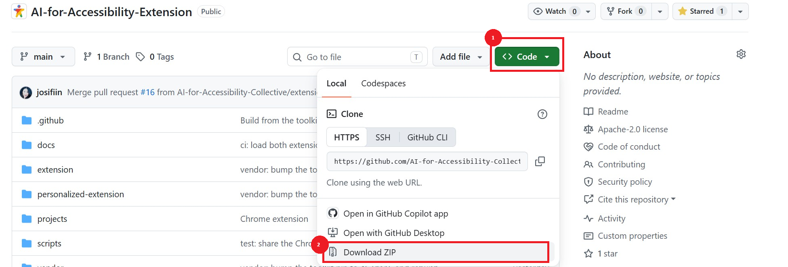
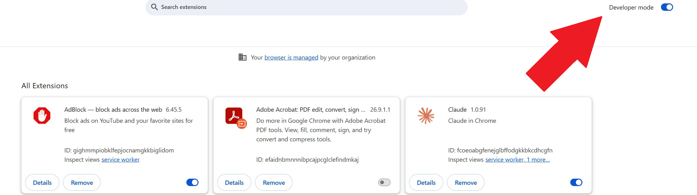
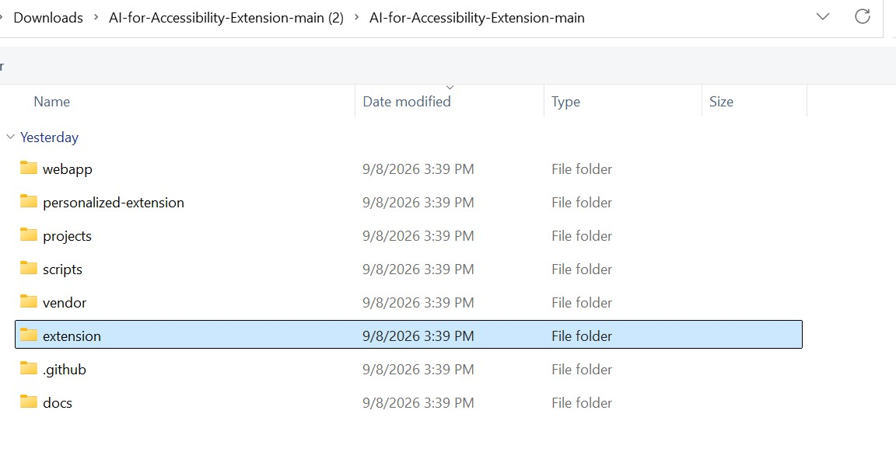
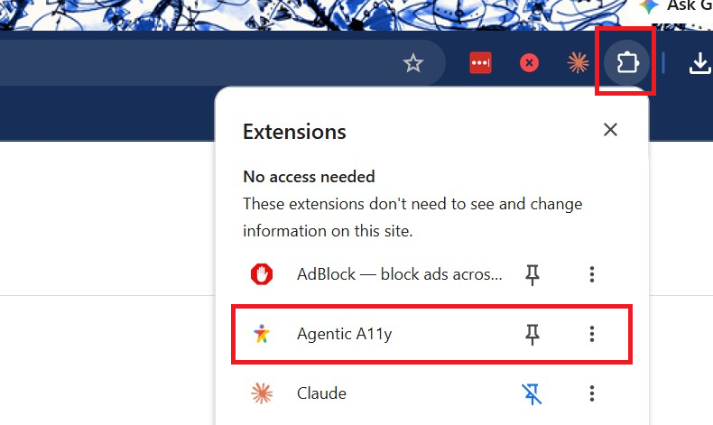
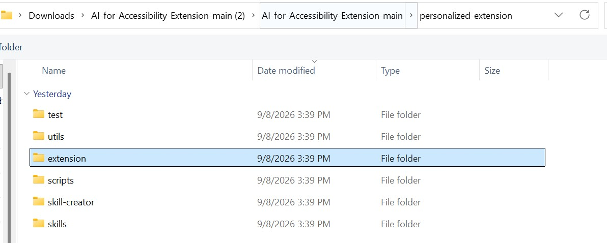
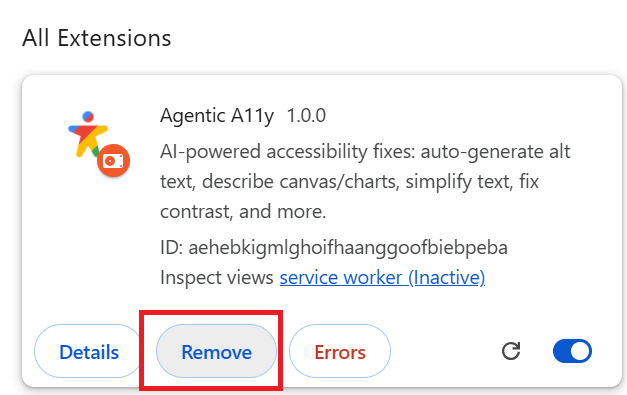

# Getting started

You can install and try the AI for Accessibility extensions in Chrome without
knowing how to code or how to use GitHub.

This is an early research version. Things may break or change, and we haven't
tested yet how well it works for any particular person. Keep using the
assistive technology you rely on, such as your screen reader or magnifier.

## What you need

- A computer with Windows, Mac or Linux (not a phone or tablet)
- Google Chrome, version 120 or later
- About ten minutes
- *(Optional)* A Google account, for the AI features

## The two extensions

- The original extension: pick a profile (e.g., Low Vision or Dyslexia) and
  pages change to match, e.g., bigger text, dark mode, less motion or a
  cleaner reading view. We recommend starting with this one.
- The personalized extension: you describe your needs in your own words, and
  it learns from what you change, suggests changes, and can make new page
  fixes for you. It is more experimental.

## Installing the original extension

1. Download the project. On the project's GitHub page, click the green
   **Code** button near the top, then **Download ZIP**.

   

2. Unzip it. Open your Downloads folder and double-click the ZIP file. You'll
   get a folder named `AI-for-Accessibility-Extension-main`.

3. Open Chrome's extensions page. Click the address bar, type
   `chrome://extensions` and press Enter.

4. Turn on **Developer mode** with the switch in the top-right corner. This
   lets you install an extension from a folder. You can turn it off again
   later, and Chrome may sometimes remind you that it's on.

   

5. Click **Load unpacked**. In the window that opens, open the
   `AI-for-Accessibility-Extension-main` folder, click once on the `extension`
   folder inside it, and confirm.

   

   If Chrome says the manifest is missing, you picked the outer folder. Open
   it and pick the `extension` folder inside.

6. Pin the icon. Click the puzzle-piece icon to the right of the address bar,
   then click the pin next to **Agentic A11y**.

   

7. Try it. Open a news article or any long page, click the icon and choose
   **Low Vision**. The text should get bigger and more spaced out right away.
   To put the page back, click **Reset** or turn the profile off.

## AI features

Everything above works without an account and costs nothing. Some features
use AI, e.g., describing pictures, captioning videos, simplifying text and
translating. These need a Gemini API key, which is a code from Google that
lets the extension use Google's AI on your behalf.

Google gives everyone a free daily allowance, and many people stay within it.
[COSTS.md](COSTS.md) explains what it costs and how to get and enter a key.

## Your information

What the extension learns about you stays on your computer. Page content is
sent to Google's AI only when you use an AI feature with your own key, and
nothing is sold or sent to advertisers. For more, see
[DATA-AND-PRIVACY.md](DATA-AND-PRIVACY.md) and
[WHAT-TO-EXPECT.md](WHAT-TO-EXPECT.md), which lists what could go wrong.

## Installing the personalized extension

1. Follow steps 1 to 5 above, but in step 5 open the `personalized-extension`
   folder and pick the `extension` folder inside it.

   

2. Keep Developer mode on. The page fixes it makes for you only run while
   it's on.

3. If you have Chrome 138 or later, click **Details** on the extension's card
   at `chrome://extensions` and turn on **Allow User Scripts**.

When it starts, it asks you to describe your needs in your own words and pick
what sounds useful. It only suggests changes to your profile, and nothing
changes until you say yes.

### The browser agent

The personalized extension also has a browser agent that can do a task for
you, e.g., booking a room or returning an order. To have the extension check
the agent's work, turn on **Check the agent's work** in the popup under
Browser Agent, or in the side panel.

With it on, the extension reads your request and each page the agent visits,
asks you when there is a choice to make (e.g., which room to book), and checks
with you before it pays, books, sends or deletes anything. For example, if a hotel
costs more than the budget you gave, it asks whether to raise the budget or
look somewhere else. Tasks take about 15 seconds longer to start, and it uses
the same Gemini key as the agent.

## Updating

The extension doesn't update itself. When there is a new version, download
the ZIP again, replace your old folder with the new one, and click the refresh
arrow on the extension's card at `chrome://extensions`.

## Removing it

1. Type `chrome://extensions` in the address bar and press Enter.

2. On the extension's card, click **Remove** and confirm.

   

This deletes everything it stored on your computer, including what it learned
about you. If you entered an API key and want to delete it from Google too,
delete it at [Google AI Studio](https://aistudio.google.com/apikey).

## If something goes wrong

1. Chrome says the manifest is missing: you picked the outer folder in step 5.
   Pick the `extension` folder inside it.

2. The icon does nothing or the page doesn't change: click the refresh arrow
   on the extension's card, then reload the page. Some pages don't allow
   extensions at all, e.g., Chrome's own pages and the Chrome Web Store, so
   try a news article.

3. The AI features say the key is missing or over the limit: see
   [COSTS.md](COSTS.md). The free allowance resets every day.

4. Anything else: see [TROUBLESHOOTING.md](TROUBLESHOOTING.md) (its later
   sections are for developers), or open an issue telling us what you clicked
   and what you saw. If you'd rather not use GitHub, see
   [SUPPORT.md](../SUPPORT.md) for how to email us.
